<p align="center">
  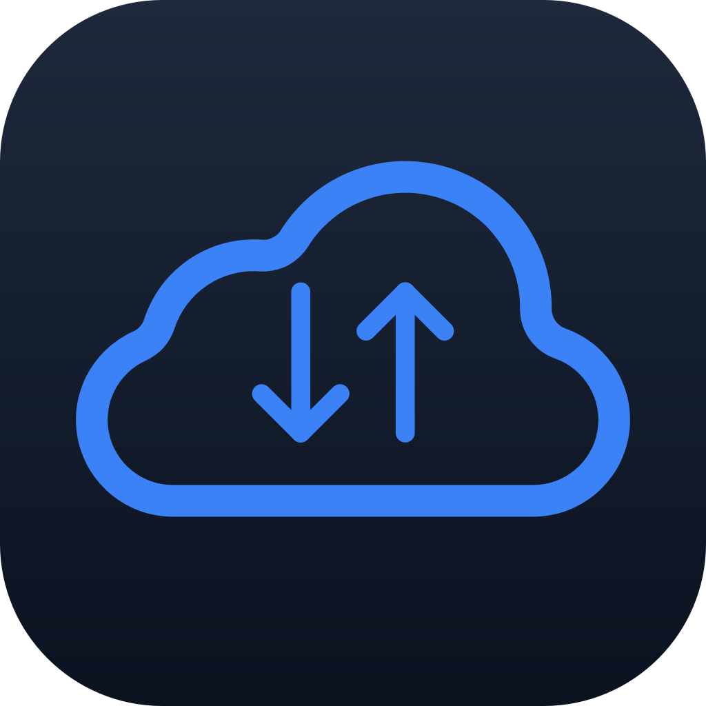
</p>

<h1 align="center">Skyfold</h1>

<p align="center">
  <b>iCloud Photos, iCloud Drive, Apple Notes and Safari bookmarks on Windows, without iCloud for Windows.</b><br>
  A free, open-source tray app. Real files in real folders, synced in both directions.
</p>

<p align="center">
  <a href="https://zoranmod.github.io/skyfold/"></a>
  <a href="../../releases/latest"></a>
  <a href="../../releases"></a>
  <a href="LICENSE"></a>
  
</p>

<p align="center">
  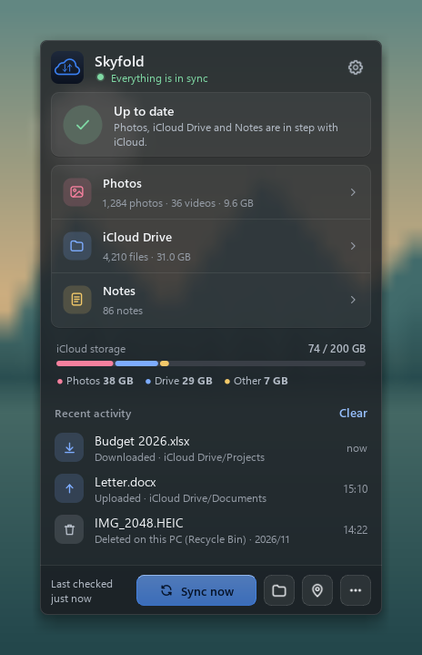
  &nbsp;
  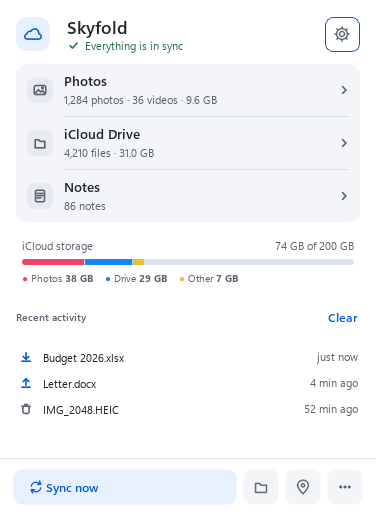
</p>

---

## Features

- **iCloud Photos.** Downloads your whole library (photos, videos, Live Photo videos) to a folder you choose: all in one folder, by year, or by year and month. **Deletions travel both ways:** delete on the iPhone and the PC copy goes to the Recycle Bin; delete on the PC and the photo goes to "Recently Deleted" in iCloud.
- **Upload from the PC (optional).** Turn on *Upload photos and videos I add to this folder to iCloud Photos* (**Settings → Photos**) and photos and videos in the photos folder that Skyfold didn't download go up to iCloud Photos and appear on your iPhone, **including ones already there when you turn it on**. A file is sent once it has stayed unchanged for two minutes. Sending is **one-way**: the file stays an ordinary file on the PC, deleting it on the PC or on the iPhone doesn't delete it on the other side, and Skyfold doesn't download it back as a second copy. Album folders, hidden files and cloud placeholders are never sent.
- **One photos folder per Apple ID.** If you sign in with another Apple ID, Skyfold asks you to choose a photos folder for it; a folder that belongs to another Apple ID isn't synced. Downloaded photos sync deletions both ways; photos you send are one-way. Skyfold follows renamed and moved photos by their Windows file id; an editor that replaces the file plus a rename before the next check can still look like a deletion.
- **A Photos window, as on an iPad.** Click *Photos* in the tray panel: your synced photos and videos edge to edge, with *Years*, *Months* and *All Photos*, and Recently added, Favourites, Videos, Live Photos, Screenshots and your albums in the sidebar. A viewer with a film strip and the photo's details, smooth scrolling, `Ctrl` + wheel to make the photos larger or smaller, and the mouse's Back and Forward buttons. **A heart here is a heart on your iPhone**, and *Delete* asks first, then moves the files to the Recycle Bin (iCloud gets them in "Recently Deleted"). It reads the files already on your PC, so it works offline. Prefer File Explorer? Switch it off in **Settings → Photos**, and a click on *Photos* opens the photos folder instead.
- **Albums as folders.** Every album you made in Photos also appears under `Albums\`, as hard links that take **no extra disk space**.
- **iCloud Drive, two-way.** A full local copy of your Drive, or only the folders you pick. New, changed, deleted, **renamed and moved** files and folders are synced in both directions. If a file changed on both sides, both versions are kept.
- **Apple Notes, read and searched on the PC.** Click *Notes* in the tray panel for a Notes window with your folders, your notes and the note itself, with its checklists, tables, pictures and scans. Search finds words in the text of your notes too, with or without accents, and you can zoom the text, sort the list and fill the screen. Every unlocked note is also saved as a web page in the same folders as in Notes, plus a `Notes.html` library you can open in any browser. One-way (iCloud → PC) and read-only.
- **Safari bookmarks for Firefox and Chrome.** Your Safari bookmarks from iPhone, iPad or Mac as a bookmarks file that Firefox, Chrome and Edge import, kept up to date, with your folders in Safari's order. Read-only: nothing changes in iCloud.
- **Find My.** Your devices with battery and last-seen time, a map link, and **Play sound**. (Apple asks for your password again after each PC restart before it shows them.)
- **iCloud storage** at a glance in the tray panel.
- **Built to be safe.** Nothing is deleted permanently, big deletions wait for your OK, and a missing or unplugged folder is never read as "delete everything".
- **Updates itself.** Skyfold tells you when a new version is out, shows what's new, and updates with one click (your settings and files stay as they are).
- **Portable and light.** Unzip and run. Follows the Windows light/dark theme, or pick Light, Dark or a pure black OLED theme. English and Bosnian.

> **Skyfold is a public beta.** Two-way iCloud Drive sync is new and has been through many rounds of independent review, but it hasn't met every real-world folder yet. Skyfold always asks before deleting more items than your limit, and nothing it deletes is permanent (Recycle Bin / "Recently Deleted"). Please keep a backup of anything important and [report problems](https://github.com/zoranmod/skyfold/issues).

## Screenshots

<p>
  <a href="https://zoranmod.github.io/skyfold/#video">▶ <b>Watch Skyfold in 48 seconds</b></a> (on the website; the photos, files and notes in it are made up)
</p>
<p>
  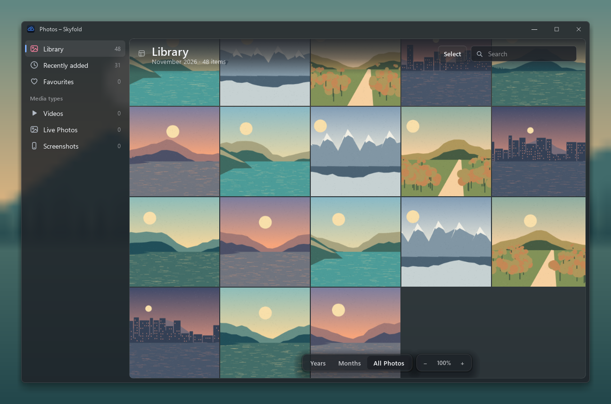
</p>
<p>
  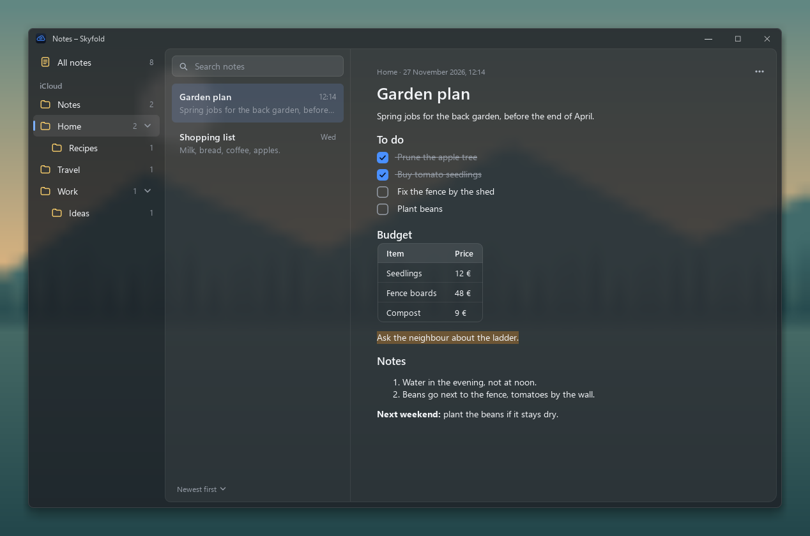
</p>
<p>
  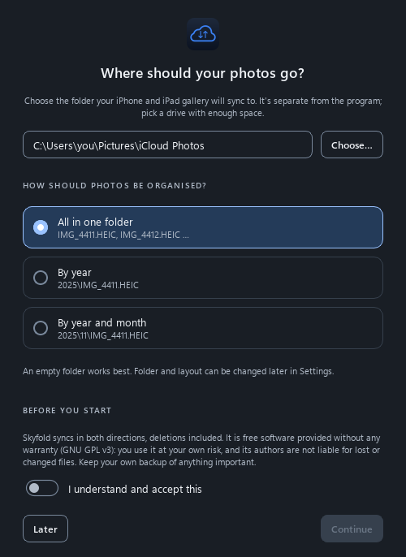
  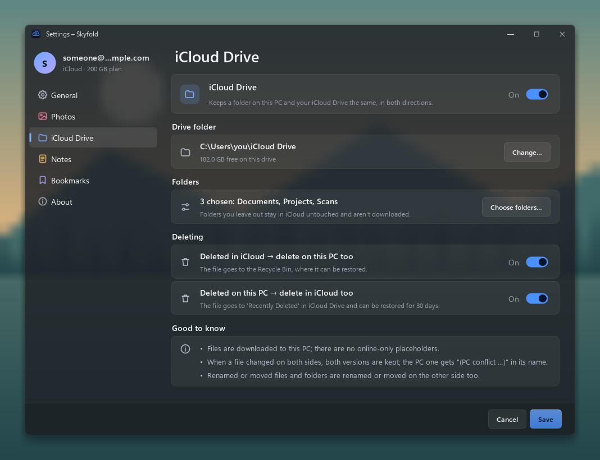
</p>
<p>
  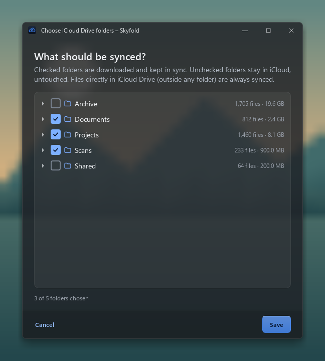
  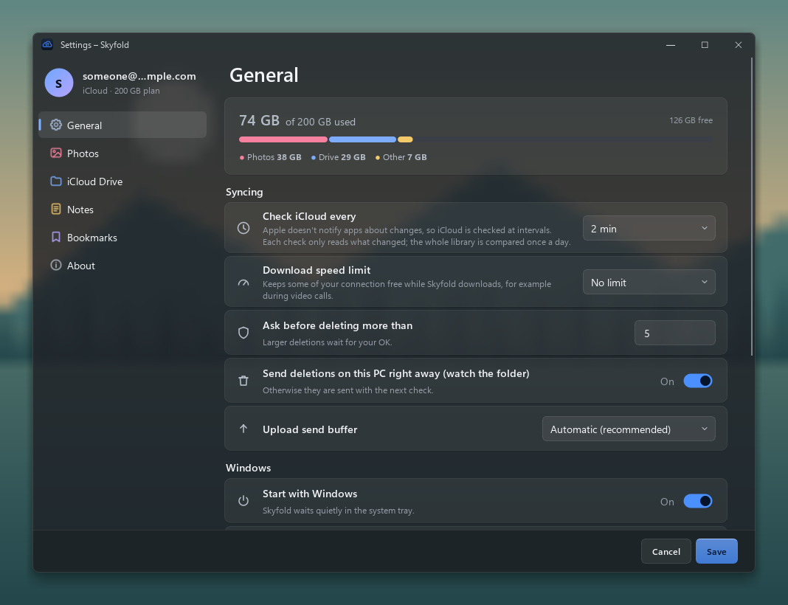
</p>
<p>
  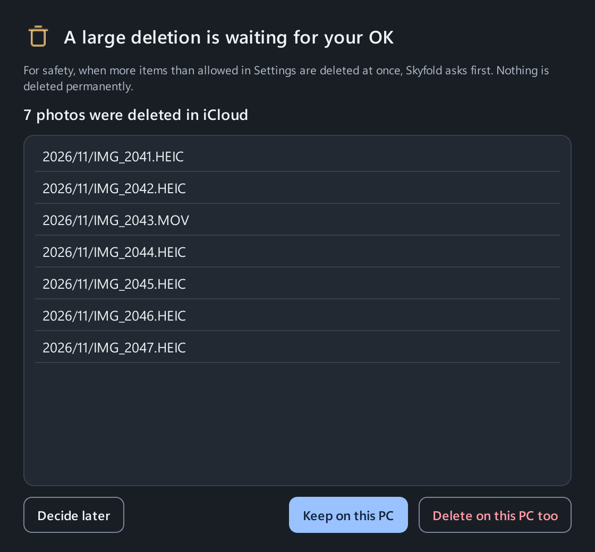
  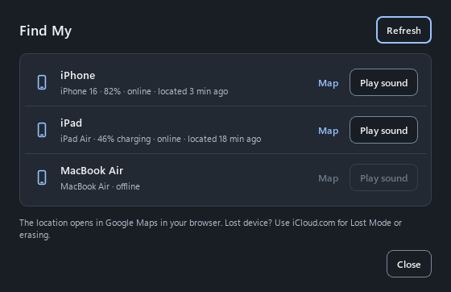
</p>
<p>
  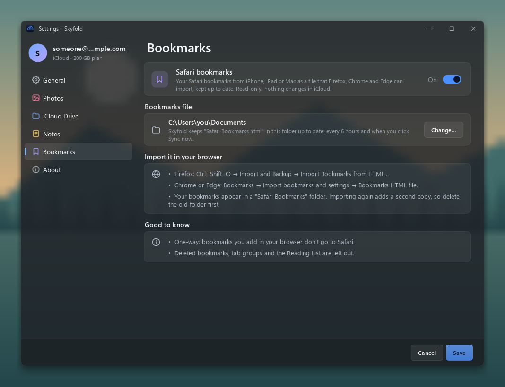
  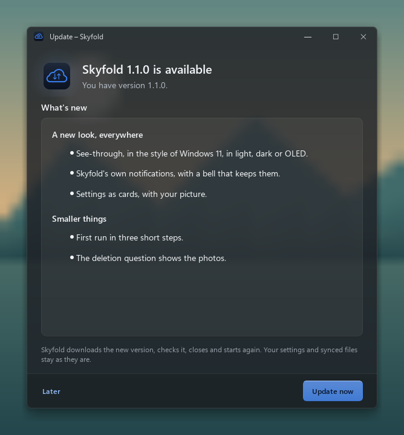
</p>
<p>
  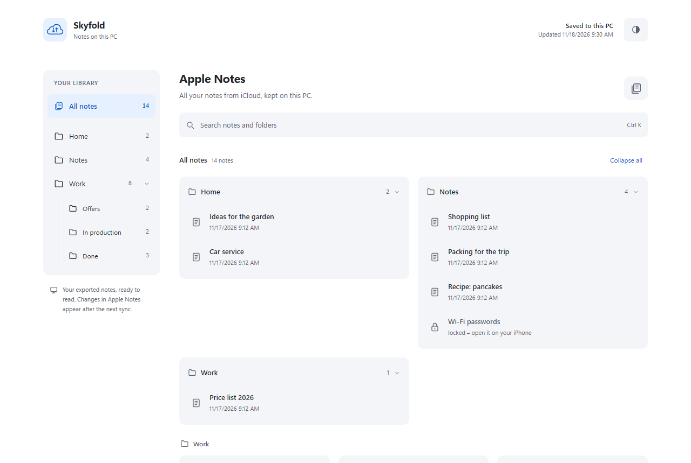
</p>

## Safari bookmarks in Firefox or Chrome

1. In Skyfold: **Settings → Bookmarks**, turn it on (the file goes to your Documents folder unless you choose another), **Save**, then **Sync now**. (Before 1.0.24 this was under *Settings → Notes*.)
2. Skyfold writes **`Safari Bookmarks.html`** and refreshes it every 6 hours and when you click **Sync now**.
3. Import it once:
   - **Firefox:** Ctrl+Shift+O → *Import and Backup* → *Import Bookmarks from HTML…*
   - **Chrome / Edge:** Bookmarks → *Import bookmarks and settings* → *Bookmarks HTML file*.
4. Your bookmarks appear in a **Safari Bookmarks** folder, with the same folders and order as in Safari. Deleted bookmarks, tab groups and the Reading List are left out.

**Without importing (Edge): the Skyfold – Safari Bookmarks extension.** Install it from [**Edge Add-ons**](https://microsoftedge.microsoft.com/addons/detail/ggcdepiimncfgfelhikkbjpdfikmfhdj) (free; its code is in [extension/](extension/)). With Safari bookmarks turned on in Skyfold, it keeps a **Safari Bookmarks** folder under *Other favorites* up to date by itself (every 30 minutes and on *Update now*), with no file to import. It gets the bookmarks from Skyfold on your PC and never goes online, so click **Sync now** in Skyfold first if you want the very latest. Firefox and Chrome versions are on the way.

Skyfold only *reads* your bookmarks from iCloud. It's one-way (Safari → browser): bookmarks you add in your browser don't go to Safari. With the file, importing again adds a second copy of the folder, so delete the old one first; the extension keeps one folder and replaces its content, so don't keep your own favorites inside it. It needs *Access iCloud Data on the Web* (see Requirements), like the rest of Skyfold.

## Why not iCloud for Windows?

Apple's app works for many people. Skyfold is for when it doesn't suit you:

| | Skyfold | iCloud for Windows |
|---|---|---|
| Files | Real files on disk, always available offline | Mostly online-only placeholders in Explorer |
| Photos layout | One folder, by year, or by year/month; albums as hard-linked folders | Apple's layout |
| New photos from the PC | Optional: photos and videos you add to the folder go to iCloud Photos | Yes |
| Apple Notes | Read and searched in Skyfold, and saved as web pages | Not available |
| Safari bookmarks | One-way export file for Firefox / Chrome / Edge | Two-way, through Apple's browser extension |
| Install | Portable zip, no installer, no Microsoft Store | Microsoft Store app |
| Source | Open source (GPLv3) | Closed source |

Apple's app does things Skyfold doesn't: passwords/keychain, two-way bookmark sync, mail/contacts/calendar, and online-only files. If you need those, keep using it.

## Install

1. Download **`Skyfold-windows.zip`** from the [latest release](../../releases/latest).
2. Unzip it to a normal folder, for example `C:\Apps\Skyfold`.
3. Run **`Skyfold.exe`**.
   - Skyfold isn't code-signed, so Windows SmartScreen may say *"Windows protected your PC"*. Click **More info → Run anyway**. The zip is built from this repository by GitHub Actions; its SHA-256 is attached to every release.
   - Unzip first: don't run it from inside the zip. On a new Windows 11 PC, *Smart App Control* may block unsigned apps altogether.
   - If your antivirus flags `Skyfold.exe` (for example a Defender name ending in `!ml`, a guess by resemblance), it is most likely a false alarm. Check the download against the release's SHA-256 or with `gh attestation verify`, and please report it in an issue.
   - The Skyfold icon appears in the system tray. On Windows 11 it may be hidden behind the **^** arrow; drag it onto the taskbar to keep it visible.
4. Choose where your photos should go and accept the no-warranty notice.
5. Sign in with your Apple ID and enter the 6-digit code from your iPhone, iPad or Mac (or the SMS code).
6. Optional: turn on **iCloud Drive** and **Notes** in Settings.

To start Skyfold with Windows, turn on **Settings → General → Start with Windows**. Skyfold writes that entry only when you switch it on, never by itself; if you move the Skyfold folder, the switch shows off until you turn it on again.
**Updates:** from version 1.0.10 on, Skyfold checks for a new version about a minute after it starts and then once a day, and updates itself with one click (**Settings → About → Check for updates** checks right away). It downloads the release from this repository and checks its SHA-256 and that GitHub's build attestation names this repository's release workflow and tag. Then it replaces only the program (`Skyfold.exe` and `_internal`); your `data` folder and synced files are never touched, and if anything goes wrong the previous version is put back. To update by hand (e.g. from 1.0.9 or older): quit Skyfold, replace `Skyfold.exe` and the `_internal` folder with the ones from the new zip, and keep the `data` folder.
To uninstall, first turn off *Start with Windows* and *Safari bookmarks* in Settings and click **Save** (so Skyfold removes its startup entry and browser link), quit Skyfold, then delete the program folder and `%LOCALAPPDATA%\Skyfold`. Your synced photos, Drive and notes folders are left untouched.

**Requirements**

- Windows 10 or 11 (64-bit).
- An Apple ID with two-factor authentication. Hardware security keys and the old two-step verification aren't supported.
- On your iPhone: **Settings → [your name] → iCloud → Access iCloud Data on the Web** must be on. It is on by default, unless you use Advanced Data Protection.

## What to expect from the first sync

- **Photos** start downloading right away, newest first. A large library can take hours; Skyfold keeps going in the background and picks up where it left off after a restart.
- **iCloud Drive** shows how much will be downloaded and how much disk space will be left before you turn it on. Skyfold always keeps 2 GB free on the disk.
- **The first Drive download is slow for many small files.** Apple limits how fast one account can download, to roughly 1 to 2 files per second, no matter how fast your connection is. A Drive with 20,000 files can take several hours. Big files go at your connection's speed. After the first sync only changes are transferred.
- **Uploads** go from disk without loading big files into memory, with progress, speed and time left in the panel. New iCloud Drive files go up three at a time and photos two at a time, each on its own connection. Apple limits each upload connection, so the speed of a single file varies (we measured 2 to 13 MB/s on a 200 Mbit/s line); several files together go faster.
- You can limit the download speed in Settings, and pause at any time from the tray. *Stop* also stops a big upload in the middle; it is sent again from the start next time.

## How syncing works

- Apple doesn't notify third-party apps about changes, so iCloud is **checked at intervals**: Photos every 2 minutes by default (each check only reads what changed), iCloud Drive in full once an hour or when you click **Sync now**. **Changes on the PC are noticed within seconds** (a new photo to upload waits until it has been unchanged for two minutes).
- **Deletions are never permanent.** PC files go to the Recycle Bin; iCloud items go to "Recently Deleted" (30 days).
- **Big deletions wait for you.** If more items than your limit (default 5) disappear at once on one side, Skyfold asks before deleting them on the other. For iCloud Drive it also asks when more than half of your files would go (from 5 items up). Notes pages and Safari bookmarks follow iCloud without asking.
- **Deletions in one direction can be turned off** (Settings → Photos / iCloud Drive). For Drive this means the remaining copy syncs back: a file deleted on the PC downloads again, one deleted in iCloud uploads again.
- **Conflicts keep both copies.** If a Drive file changed on both sides, iCloud's version keeps the name and the PC version is saved as `name (PC conflict …)`.

## Privacy and security

- **Your password is never stored.** It is only used to sign in, with Apple's own sign-in protocol and two-factor authentication.
- **Skyfold talks to Apple, and once a day to GitHub.** There is no Skyfold server, no telemetry, no analytics and no crash reporting. The daily update check asks GitHub's public API for the latest Skyfold release (and, before an update, its build attestation) and sends nothing about you (only the client name "Skyfold/<version>"); turn it off in **Settings → General**.
- **Checked before every request.** Skyfold checks the address of each of its own requests, and of each redirect, before anything is sent: Apple's iCloud servers or GitHub's update servers, over HTTPS, and nothing else. Any other address is refused and the panel says so. (A proxy you set up in Windows is still used, as by any program.)
- **Links you choose to open** (iCloud.com, GitHub, links in your notes) open in your browser or default app. Clicking **Map** in Find My sends the device's shown location to Google Maps in your browser.
- **What is stored on your PC:**
  - Apple's session cookies and the sync database: `%LOCALAPPDATA%\Skyfold` (this PC only, never next to the app, so they aren't uploaded if the app sits in OneDrive or iCloud Drive). The session lasts about two months.
  - Settings, including your Apple ID email: the `data` folder next to `Skyfold.exe` (or `%LOCALAPPDATA%\Skyfold\data` if the program folder can't be written, e.g. under Program Files).
  - A log file: `%LOCALAPPDATA%\Skyfold\skyfold.log` (max. about 3 MB, rotated). It contains file and folder names, album names and note titles, but no password.
  - Only while you record connection diagnostics: `%LOCALAPPDATA%\Skyfold\connections.log` (two files of at most 512 KB). It has only the kind of each request (sign-in, iCloud service, iCloud download, update), Apple's status code and how long it took: no names, file names, addresses, ids, cookies or passwords. **Settings → General → Delete** removes it.
  - If Skyfold ever crashes: `%LOCALAPPDATA%\Skyfold\crash.log`, with the parts of the program that were running (no note text, file contents or password).
  - With Safari bookmarks on: your bookmarks' titles and addresses in `%LOCALAPPDATA%\Skyfold\safari-bookmarks.json` (for the browser extension), besides the exported HTML file.
- **Anyone who can read `%LOCALAPPDATA%\Skyfold\session` can access your iCloud** until the session expires, like a browser that's still signed in. Use Skyfold on a PC you trust. **Settings → General → Sign out** deletes the session.
- To report a security problem privately, see [SECURITY.md](SECURITY.md).

## Limitations

- **Uploading new photos from the PC is optional and off by default** (Settings → Photos). A Live Photo copied from an iPhone (`IMG_1234.HEIC` + `IMG_1234.MOV`) goes up as a still photo; its video part stays on the PC. Edits to a photo that is already synced aren't uploaded. Sent photos aren't synced back and forth: delete them on each side yourself if you want them gone.
- **Edited photos** are downloaded as originals, without your edits.
- **Shared albums, the iCloud Shared Photo Library and smart albums** (Favorites, etc.) aren't synced. Photos in the **Hidden** album aren't downloaded, and hiding a photo on the iPhone moves its PC copy to the Recycle Bin.
- **No online-only placeholders, by design.** iCloud Drive files are real downloads, so you need enough disk space for the folders you choose.
- **Mac packages** (folders that a Mac shows as one file, such as `.app` or `.xcodeproj`) are left in iCloud and skipped.
- **Notes are one-way and read-only** (iCloud → PC): you read them in Skyfold or your browser, but edit them on your iPhone, iPad or Mac. Locked notes can't be read; they are only listed.
- **A shared iCloud Drive file edited on the PC becomes a new document in iCloud.** Apple's web interface that Skyfold uses replaces a file by moving the old version to Recently Deleted and adding the new one (other tools do the same). For a file you shared with others on its own, they may lose access and need to be invited again; edit such files on an Apple device, or share the folder instead.
- **Safari bookmarks are one-way** (Safari → a file your browser imports). Bookmarks made in Firefox or Chrome don't go back to Safari.
- **Advanced Data Protection:** Skyfold needs *Access iCloud Data on the Web* to be on. Without it, Apple doesn't let Skyfold read your data.
- **Messages, calls, contacts, calendars, passwords and Lost Mode** aren't included. For lost devices, use iCloud.com.
- Skyfold uses the same web services as iCloud.com. If Apple changes them, something may stop working until Skyfold is updated.

## FAQ

**Is this an official Apple app?**
No. Skyfold is an independent project and isn't affiliated with Apple.

**Why does Windows warn me when I start it?**
The exe isn't code-signed (certificates cost money every year). The source and the build are public: the release zip is built by GitHub Actions from this repository.

**Do I have to sign in again?**
About every two months, when Apple's session expires. Skyfold tells you in the tray.
**Find My is the exception:** after every restart of the PC, Apple asks for your password once more before it shows your devices. Skyfold never stores the password, so Find My shows a **Sign in again** button; syncing keeps working without it.

**Can I put the app or my synced folders in OneDrive / Dropbox?**
The app, yes: the session and database stay local. Your photos or Drive folder, better not: everything would be uploaded to a second cloud. Skyfold warns you if you pick such a folder.

**I deleted something by mistake.**
Check the Windows Recycle Bin, or "Recently Deleted" in Photos / iCloud Drive (iCloud.com or your iPhone) within 30 days.

**Can I move my photos folder later?**
Yes, in Settings. Skyfold also follows files you move around *inside* the folder.

**Can I edit my notes in Skyfold?**
No. Skyfold shows your notes read-only. Edit them on your iPhone, iPad or Mac; the change reaches the PC with the next sync. Locked notes can't be read, so Skyfold only lists their titles.

**Can I use it on two PCs?**
Yes, each PC has its own session and sync database.

**How do I run more than one Apple ID?**
Not supported; one account per Windows user.

## Reporting bugs

Open an [issue](../../issues/new/choose) and attach the relevant part of the log:

```
%LOCALAPPDATA%\Skyfold\skyfold.log
```

If Skyfold closed by itself (crashed), attach `crash.log` from the same folder too.

**Syncing fails or hangs?** In **Settings → General → Connection diagnostics**, click *Record for 30 minutes*, then *Sync now* and wait for the problem. *Show the file* opens `connections.log`; attach it as it is (it holds no personal data). It stops by itself after 30 minutes, when you sign out or quit Skyfold.

Paste `%LOCALAPPDATA%\Skyfold` into the Explorer address bar to open the folder. **Before posting, remove personal data**: your Apple ID email, your Windows user name in paths, and file, album or note names you don't want to share.

## Contributing

Bug reports, translations and pull requests are welcome. For larger changes, please open an issue first.

```powershell
git clone https://github.com/zoranmod/skyfold.git
cd skyfold
powershell -ExecutionPolicy Bypass -File build.ps1   # creates the environment in %LOCALAPPDATA%\Skyfold-build and writes dist\Skyfold
& "$env:LOCALAPPDATA\Skyfold-build\venv\Scripts\python.exe" -m pytest tests
```

- **Stack:** Python 3.12, Qt 6 (PySide6), PyInstaller, [pyicloud](https://github.com/timlaing/pyicloud) for Apple sign-in and the iCloud services.
- **Made with AI help:** Skyfold is written with the help of Claude (Anthropic's AI assistant). Ideas, design decisions and testing on a real iCloud account are done by a person, and the code is covered by automated tests against a fake iCloud.
- **Layout:** sync logic in `skyfold/engine.py` (Photos), `drive_engine.py` and `notes_engine.py`, each tested against a fake iCloud in `tests/`. UI in `skyfold/ui/`. Translations in `skyfold/i18n.py`.
- **Self-test:** `Skyfold.exe --selftest report.txt` checks a packaged build (CI runs it on every push).
- By contributing you agree that your contribution is licensed under the GPLv3.

## Support the project

Skyfold is free and will stay free. If it's useful to you, a ⭐ on GitHub, a bug report or a translation helps the most.

## Disclaimer

**Use Skyfold at your own risk.** Skyfold syncs in both directions, deletions included. It is provided "as is", without warranty of any kind, and its authors are not liable for any lost, changed or deleted files or any other damage arising from its use (see sections 15 and 16 of the [LICENSE](LICENSE)). The safety nets (Recycle Bin, Recently Deleted, confirmation for large deletions) are not a backup: **keep your own backup of anything important.** Skyfold asks you to accept this before it syncs anything.

Skyfold is not affiliated with, endorsed by or sponsored by Apple Inc. Apple, iCloud, iPhone, iPad, Mac, Find My and Apple Notes are trademarks of Apple Inc., registered in the U.S. and other countries.

## License

[GNU GPL v3](LICENSE). You may use, study, change and share Skyfold. If you share a changed version, it must stay open source under the same license.

---

<details>
<summary><b>Na bosanskom (kratko)</b></summary>

**Skyfold** sinhronizuje tvoje iCloud slike, iCloud Drive i Apple bilješke s Windowsom, bez Apple-ove aplikacije.

- **Brisanje slika ide u oba smjera, a Drive se sinhronizuje u oba smjera** (i preimenovanja i premještanja). Obrisani fajlovi idu u Recycle Bin ili u "Nedavno obrisano", pa se mogu vratiti.
- **Skyfold je javna beta.** Dvosmjerna Drive sinhronizacija je nova: Skyfold uvijek pita prije većeg brisanja, ali čuvaj rezervnu kopiju važnih stvari.
- **Safari oznake za Firefox i Chrome:** Postavke → Oznake. Skyfold drži ažuran fajl `Safari Bookmarks.html` koji uvezeš u Firefox (Ctrl+Shift+O → Uvoz i rezervna kopija → Uvezi oznake iz HTML-a) ili Chrome. U Edgeu je lakše: instaliraj ekstenziju [Skyfold – Safari Bookmarks](https://microsoftedge.microsoft.com/addons/detail/ggcdepiimncfgfelhikkbjpdfikmfhdj) i ona sama drži folder Safari Bookmarks ažurnim, bez uvoza. Samo čita iz iClouda; jednosmjerno.
- **Slanje slika s računara (po želji):** Postavke → Fotografije → *Šalji u iCloud slike i videe koje dodam u ovaj folder*. Slike i videi koje ubaciš u folder sa slikama šalju se u iCloud Photos i pojave se na telefonu, uključujući one koji su već u folderu kad je uključiš. Slanje je jednosmjerno: fajl ostaje običan fajl na računaru, a brisanje na jednoj strani ne briše na drugoj. Opcija je po defaultu isključena.
- **Jedan folder za slike po Apple ID-u:** kad se prijaviš drugim Apple ID-om, Skyfold traži da mu izabereš folder. Skyfold prati preimenovane i premještene slike dok Windows zadrži ID fajla; ako uređivač zamijeni fajl i preimenuješ ga prije sljedeće provjere, Skyfold to može protumačiti kao brisanje.
- **Bilješke čitaš i pretražuješ u Skyfoldu:** klikni *Bilješke* u panelu. Vidiš foldere, bilješke i samu bilješku sa slikama, a pretraga traži i po tekstu bilješki. Bilješke se čuvaju i kao web stranice s bibliotekom (Notes.html) koja se otvara u pregledniku.
- **Skyfold provjeri svaki svoj zahtjev prije slanja:** ide samo Appleovom iCloudu i GitHubu za ažuriranja.
- **Dijagnostika veze za prijavu greške:** Postavke → Općenito → *Bilježi 30 minuta*. Fajl `connections.log` nema imena, nazive fajlova, adrese ni lozinke, pa ga možeš priložiti prijavi takav kakav je.
- **Skyfold se sam ažurira:** javi kad izađe nova verzija, pokaže šta je novo i ažurira se jednim klikom (od verzije 1.0.10).
- **Program je besplatan i prenosiv.** Raspakuj ga, pokreni `Skyfold.exe` i prijavi se Apple ID-jem.
- **Jezik** se mijenja u Postavke → Općenito → Jezik.
- **Koristiš ga na vlastitu odgovornost.** Program dolazi bez garancije i autori ne odgovaraju za izgubljene fajlove. Čuvaj vlastitu rezervnu kopiju.

</details>
