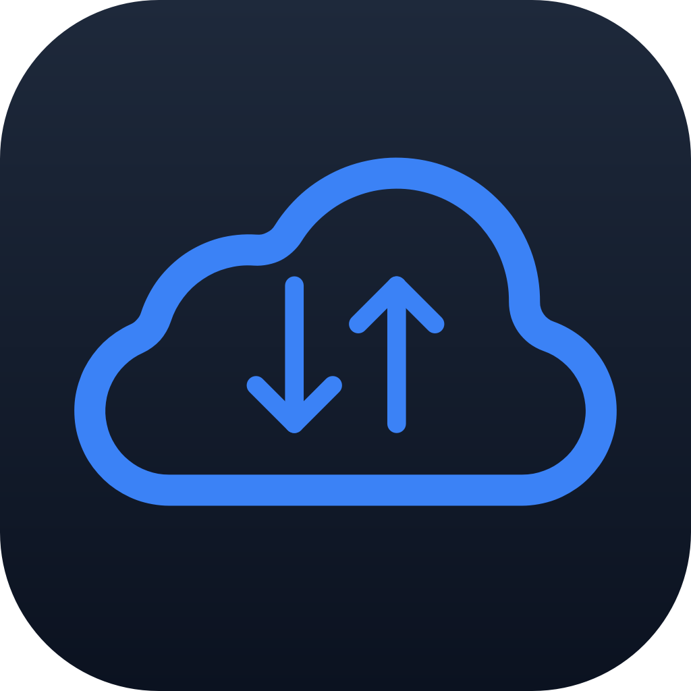
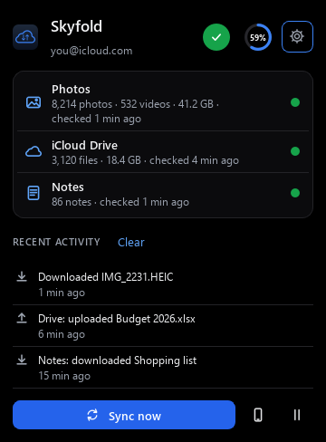
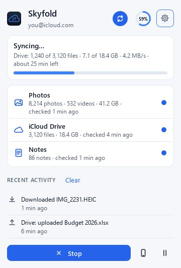
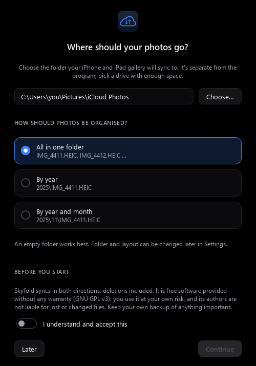
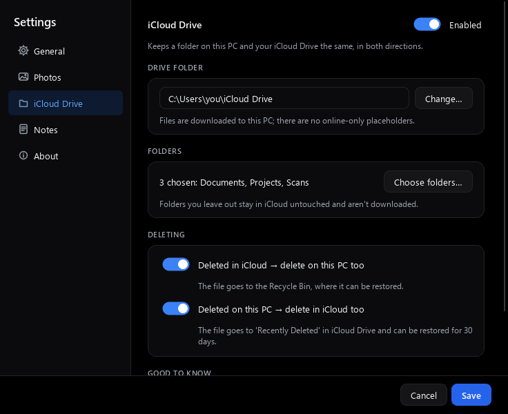
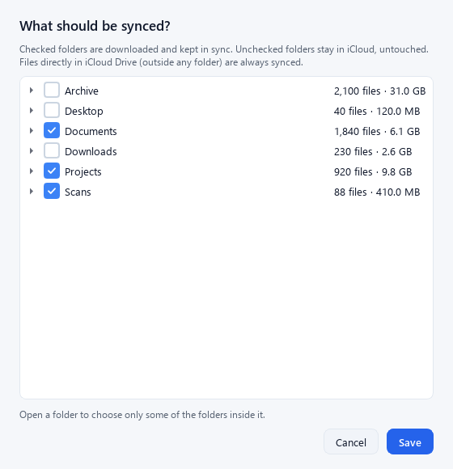
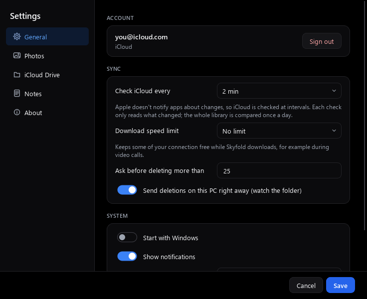
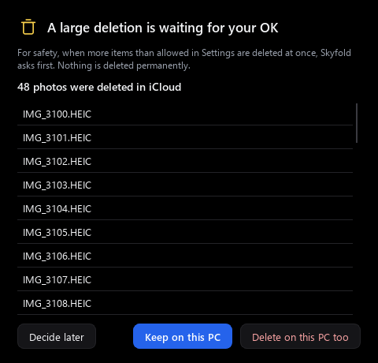
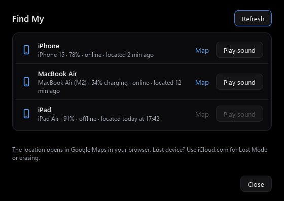

<p align="center">
  
</p>

<h1 align="center">Skyfold</h1>

<p align="center">
  <b>iCloud Photos, iCloud Drive and Apple Notes on Windows, without iCloud for Windows.</b><br>
  A free, open-source tray app. Real files in real folders, synced in both directions.
</p>

<p align="center">
  <a href="../../releases/latest"></a>
  <a href="LICENSE"></a>
  
</p>

<p align="center">
  
  &nbsp;
  
</p>

---

## Features

- **iCloud Photos.** Downloads your whole library (photos, videos, Live Photo videos) to a folder you choose: all in one folder, by year, or by year and month. **Deletions travel both ways:** delete on the iPhone and the PC copy goes to the Recycle Bin; delete on the PC and the photo goes to "Recently Deleted" in iCloud.
- **Albums as folders.** Every album you made in Photos also appears under `Albums\`, as hard links that take **no extra disk space**.
- **iCloud Drive, two-way.** A full local copy of your Drive, or only the folders you pick. New, changed, deleted, **renamed and moved** files and folders are synced in both directions. If a file changed on both sides, both versions are kept.
- **Apple Notes export.** Every note becomes a web page with its pictures and attachments, in the same folders as in Notes, plus a searchable `Notes.html` index. One-way (iCloud → PC).
- **Find My.** Your devices with battery and last-seen time, a map link, and **Play sound**. (Apple asks for your password again after each PC restart before it shows them.)
- **iCloud storage** at a glance in the tray panel.
- **Built to be safe.** Nothing is deleted permanently, big deletions wait for your OK, and a missing or unplugged folder is never read as "delete everything".
- **Portable and light.** Unzip and run. Follows the Windows light/dark theme. English and Bosnian.

## Screenshots

<p>
  
  
</p>
<p>
  
  
</p>
<p>
  
  
</p>

## Why not iCloud for Windows?

Apple's app works for many people. Skyfold is for when it doesn't suit you:

| | Skyfold | iCloud for Windows |
|---|---|---|
| Files | Real files on disk, always available offline | Mostly online-only placeholders in Explorer |
| Photos layout | One folder, by year, or by year/month; albums as hard-linked folders | Apple's layout |
| Apple Notes | Exported as browsable, searchable HTML | Not available |
| Install | Portable zip, no installer, no Microsoft Store | Microsoft Store app |
| Source | Open source (GPLv3) | Closed source |

Apple's app does things Skyfold doesn't: passwords/keychain, bookmarks, mail/contacts/calendar, uploading new photos, and online-only files. If you need those, keep using it.

## Install

1. Download **`Skyfold-windows.zip`** from the [latest release](../../releases/latest).
2. Unzip it to a normal folder, for example `C:\Apps\Skyfold`.
3. Run **`Skyfold.exe`**.
   - Skyfold isn't code-signed, so Windows SmartScreen may say *"Windows protected your PC"*. Click **More info → Run anyway**. The zip is built from this repository by GitHub Actions; its SHA-256 is attached to every release.
   - Unzip first: don't run it from inside the zip. On a new Windows 11 PC, *Smart App Control* may block unsigned apps altogether.
   - The Skyfold icon appears in the system tray. On Windows 11 it may be hidden behind the **^** arrow; drag it onto the taskbar to keep it visible.
4. Choose where your photos should go and accept the no-warranty notice.
5. Sign in with your Apple ID and enter the 6-digit code from your iPhone, iPad or Mac (or the SMS code).
6. Optional: turn on **iCloud Drive** and **Notes** in Settings.

To start Skyfold with Windows, turn on **Settings → General → Start with Windows**.
To update, quit Skyfold, replace the program files with the new zip's contents and keep the `data` folder.
To uninstall, quit Skyfold, turn off *Start with Windows* first, then delete the program folder and `%LOCALAPPDATA%\Skyfold`. Your synced photos, Drive and notes folders are left untouched.

**Requirements**

- Windows 10 or 11 (64-bit).
- An Apple ID with two-factor authentication. Hardware security keys and the old two-step verification aren't supported.
- On your iPhone: **Settings → [your name] → iCloud → Access iCloud Data on the Web** must be on. It is on by default, unless you use Advanced Data Protection.

## What to expect from the first sync

- **Photos** start downloading right away, newest first. A large library can take hours; Skyfold keeps going in the background and picks up where it left off after a restart.
- **iCloud Drive** shows how much will be downloaded and how much disk space will be left before you turn it on. Skyfold always keeps 2 GB free on the disk.
- **The first Drive download is slow for many small files.** Apple limits how fast one account can download, to roughly 1 to 2 files per second, no matter how fast your connection is. A Drive with 20,000 files can take several hours. Big files go at your connection's speed. After the first sync only changes are transferred.
- You can limit the download speed in Settings, and pause at any time from the tray.

## How syncing works

- Apple doesn't notify third-party apps about changes, so iCloud is **checked at intervals**: Photos every 2 minutes by default (each check only reads what changed), iCloud Drive in full once an hour or when you click **Sync now**. **Changes on the PC are sent right away.**
- **Deletions are never permanent.** PC files go to the Recycle Bin; iCloud items go to "Recently Deleted" (30 days).
- **Big deletions wait for you.** If more items than your limit (default 25) disappear at once, Skyfold asks before deleting anything.
- **Conflicts keep both copies.** If a Drive file changed on both sides, iCloud's version keeps the name and the PC version is saved as `name (PC conflict …)`.

## Privacy and security

- **Your password is never stored.** It is only used to sign in, with Apple's own sign-in protocol and two-factor authentication.
- **Skyfold only talks to Apple.** There is no Skyfold server, no telemetry, no analytics, no crash reporting and no update check. The only other thing it opens is Google Maps in your browser, and only when you click **Map** in Find My.
- **What is stored on your PC:**
  - Apple's session cookies and the sync database: `%LOCALAPPDATA%\Skyfold` (this PC only, never next to the app, so they aren't uploaded if the app sits in OneDrive or iCloud Drive). The session lasts about two months.
  - Settings, including your Apple ID email: the `data` folder next to `Skyfold.exe` (or `%LOCALAPPDATA%\Skyfold\data` if the program folder can't be written, e.g. under Program Files).
  - A log file: `%LOCALAPPDATA%\Skyfold\skyfold.log` (max. about 3 MB, rotated). It contains file and folder names but no password.
- **Anyone who can read `%LOCALAPPDATA%\Skyfold\session` can access your iCloud** until the session expires, like a browser that's still signed in. Use Skyfold on a PC you trust. **Settings → General → Sign out** deletes the session.
- To report a security problem privately, see [SECURITY.md](SECURITY.md).

## Limitations

- **New photos added on the PC are not uploaded** to iCloud Photos. Photos sync is download plus deletions in both directions.
- **Edited photos** are downloaded as originals, without your edits.
- **Shared albums, the iCloud Shared Photo Library and smart albums** (Favorites, etc.) aren't synced. Photos in the **Hidden** album aren't downloaded, and hiding a photo on the iPhone moves its PC copy to the Recycle Bin.
- **No online-only placeholders, by design.** iCloud Drive files are real downloads, so you need enough disk space for the folders you choose.
- **Mac packages** (folders that a Mac shows as one file, such as `.app` or `.xcodeproj`) are left in iCloud and skipped.
- **Notes are one-way** (iCloud → PC). Locked notes can't be read; they are only listed.
- **Advanced Data Protection:** Skyfold needs *Access iCloud Data on the Web* to be on. Without it, Apple doesn't let Skyfold read your data.
- **Messages, calls, contacts, calendars, passwords and Lost Mode** aren't included. For lost devices, use iCloud.com.
- Skyfold uses the same web services as iCloud.com. If Apple changes them, something may stop working until Skyfold is updated.

## FAQ

**Is this an official Apple app?**
No. Skyfold is an independent project and isn't affiliated with Apple.

**Why does Windows warn me when I start it?**
The exe isn't code-signed (certificates cost money every year). The source and the build are public: the release zip is built by GitHub Actions from this repository.

**Do I have to sign in again?**
About every two months, when Apple's session expires. Skyfold tells you in the tray.
**Find My is the exception:** after every restart of the PC, Apple asks for your password once more before it shows your devices. Skyfold never stores the password, so Find My shows a **Sign in again** button; syncing keeps working without it.

**Can I put the app or my synced folders in OneDrive / Dropbox?**
The app, yes: the session and database stay local. Your photos or Drive folder, better not: everything would be uploaded to a second cloud. Skyfold warns you if you pick such a folder.

**I deleted something by mistake.**
Check the Windows Recycle Bin, or "Recently Deleted" in Photos / iCloud Drive (iCloud.com or your iPhone) within 30 days.

**Can I move my photos folder later?**
Yes, in Settings. Skyfold also follows files you move around *inside* the folder.

**Can I use it on two PCs?**
Yes, each PC has its own session and sync database.

**How do I run more than one Apple ID?**
Not supported; one account per Windows user.

## Reporting bugs

Open an [issue](../../issues/new/choose) and attach the relevant part of the log:

```
%LOCALAPPDATA%\Skyfold\skyfold.log
```

Paste `%LOCALAPPDATA%\Skyfold` into the Explorer address bar to open the folder. **Before posting, remove personal data**: your Apple ID email, your Windows user name in paths, and file, album or note names you don't want to share.

## Contributing

Bug reports, translations and pull requests are welcome. For larger changes, please open an issue first.

```powershell
git clone https://github.com/zoranmod/skyfold.git
cd skyfold
powershell -ExecutionPolicy Bypass -File build.ps1   # creates the environment in %LOCALAPPDATA%\Skyfold-build and writes dist\Skyfold
& "$env:LOCALAPPDATA\Skyfold-build\venv\Scripts\python.exe" -m pytest tests
```

- **Stack:** Python 3.12, Qt 6 (PySide6), PyInstaller, [pyicloud](https://github.com/timlaing/pyicloud) for Apple sign-in and the iCloud services.
- **Made with AI help:** Skyfold is written with the help of Claude (Anthropic's AI assistant). Ideas, design decisions and testing on a real iCloud account are done by a person, and the code is covered by automated tests against a fake iCloud.
- **Layout:** sync logic in `skyfold/engine.py` (Photos), `drive_engine.py` and `notes_engine.py`, each tested against a fake iCloud in `tests/`. UI in `skyfold/ui/`. Translations in `skyfold/i18n.py`.
- **Self-test:** `Skyfold.exe --selftest report.txt` checks a packaged build (CI runs it on every push).
- By contributing you agree that your contribution is licensed under the GPLv3.

## Support the project

Skyfold is free and will stay free. If it's useful to you, a ⭐ on GitHub, a bug report or a translation helps the most.

## Disclaimer

**Use Skyfold at your own risk.** Skyfold syncs in both directions, deletions included. It is provided "as is", without warranty of any kind, and its authors are not liable for any lost, changed or deleted files or any other damage arising from its use (see sections 15 and 16 of the [LICENSE](LICENSE)). The safety nets (Recycle Bin, Recently Deleted, confirmation for large deletions) are not a backup: **keep your own backup of anything important.** Skyfold asks you to accept this before it syncs anything.

Skyfold is not affiliated with, endorsed by or sponsored by Apple Inc. Apple, iCloud, iPhone, iPad, Mac, Find My and Apple Notes are trademarks of Apple Inc., registered in the U.S. and other countries.

## License

[GNU GPL v3](LICENSE). You may use, study, change and share Skyfold. If you share a changed version, it must stay open source under the same license.

---

<details>
<summary><b>Na bosanskom (kratko)</b></summary>

**Skyfold** sinhronizuje tvoje iCloud slike, iCloud Drive i Apple bilješke s Windowsom, bez Apple-ove aplikacije.

- **Brisanje slika ide u oba smjera, a Drive se sinhronizuje u oba smjera** (i preimenovanja i premještanja). Obrisani fajlovi idu u Recycle Bin ili u "Nedavno obrisano", pa se mogu vratiti.
- **Bilješke se čuvaju kao web stranice s pretragom.**
- **Program je besplatan i prenosiv.** Raspakuj ga, pokreni `Skyfold.exe` i prijavi se Apple ID-jem.
- **Jezik** se mijenja u Postavke → Općenito → Jezik.
- **Koristiš ga na vlastitu odgovornost.** Program dolazi bez garancije i autori ne odgovaraju za izgubljene fajlove. Čuvaj vlastitu rezervnu kopiju.

</details>
